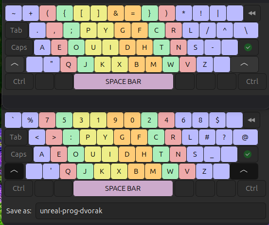

# Unreal Programmer Dvorak (URPD)

A custom keyboard layout inspired by ThePrimeagen.

### Layout




## Linux (CachyOS, Ubuntu, Kali, REMnux)

Requires `git`, `stow`, and an XKB-compatible desktop environment.

```bash
git clone https://github.com/j-waweru/dotfiles.git ~/dotfiles
cd ~/dotfiles
stow xkb
```

**GNOME (Ubuntu):**

```bash
gsettings set org.gnome.desktop.input-sources sources "[('xkb', 'us'), ('xkb', 'unreal-prog-dvorak')]"
```

**Hyprland (CachyOS):** Add to `~/.config/hypr/hyprland.conf`:

```text
input {
    kb_layout = us
    kb_variant = unreal-prog-dvorak
}
```

## Windows

1. Install [Microsoft Keyboard Layout Creator (MSKLC)](https://www.microsoft.com/en-us/download/details.aspx?id=102134).
2. [Open the URPD layout file](./Windows/UnrealProgrammersDvorak.klc) in MSKLC.
3. Select **Project → Build DLL and Setup Package**, then run the generated `setup.exe`.

